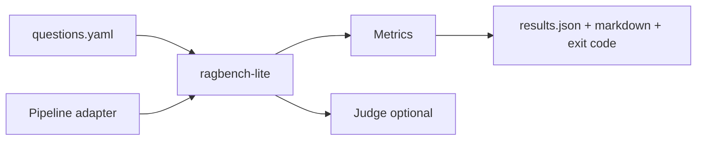

# ragbench-lite

CLI + library that evaluates any RAG pipeline against a YAML golden-question set.

Metrics: retrieval hit-rate@k, MRR, answer-contains pass rate, LLM-as-judge faithfulness (1–5), latency p50/p95. Diff scorecards between pipeline versions and fail CI when thresholds regress.

## Quickstart

```bash
npm install -g ragbench-lite
# or
npx ragbench run --questions fixtures/questions.yaml --corpus fixtures/corpus.json
```

```ts
import { runBench, createMemoryAdapter, createMockJudge } from "ragbench-lite";

const scorecard = await runBench(questions, pipeline, {
  k: 5,
  judge: createMockJudge(),
  thresholds: { hitRateAtK: 0.8 },
});
```

## Architecture



## Golden set format

```yaml
- id: q1
  question: "What is the max operating temperature of product X-200?"
  expected_sources: ["datasheets/x200.pdf#thermal"]
  expected_answer_contains: ["85°C"]
  judge: true
```

## Adapters

- **Memory cosine baseline** — embed docs + query via an `Embeddings` interface
- **HTTP** — `POST { question }` → `{ answer, retrievedChunks }`

Judges: mock (CI), OpenAI, Anthropic. Prompt is versioned in-repo (`JUDGE_PROMPT_VERSION`).

## License

MIT © Muhammad Zia

## Publishing

Maintainers: see [PUBLISH.md](./PUBLISH.md) for first-time GitHub push and npm release via version tags.
